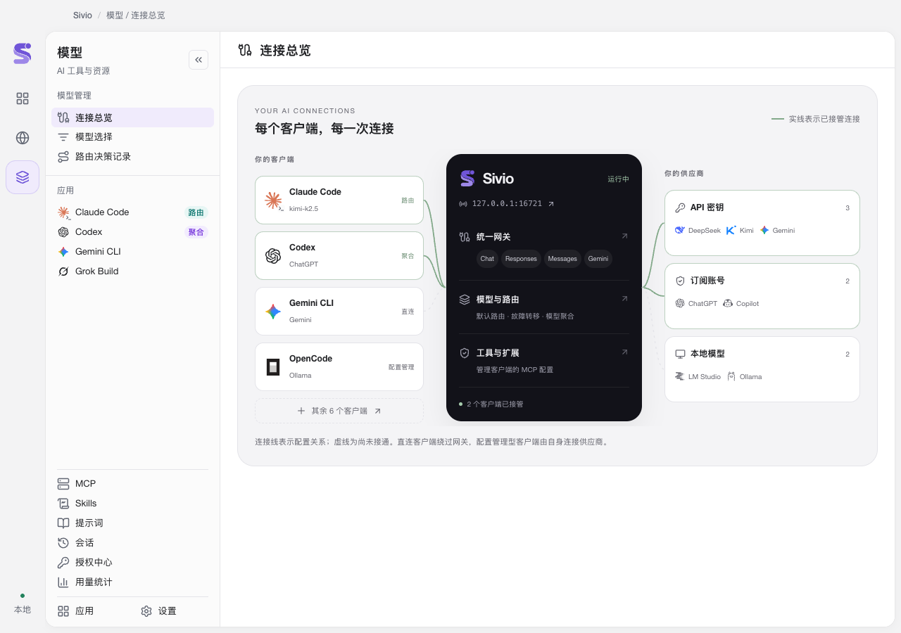
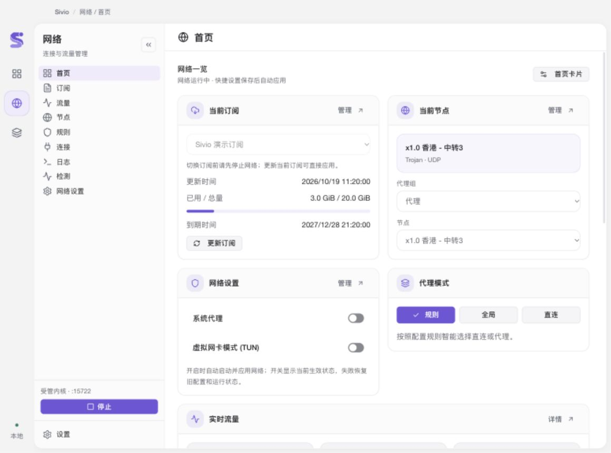
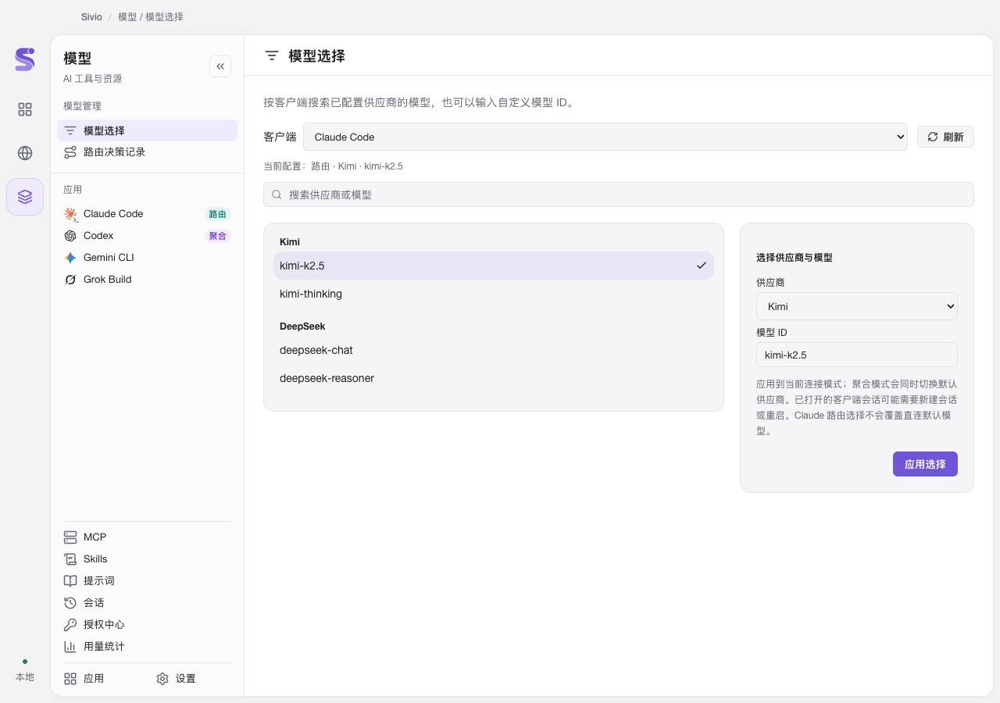
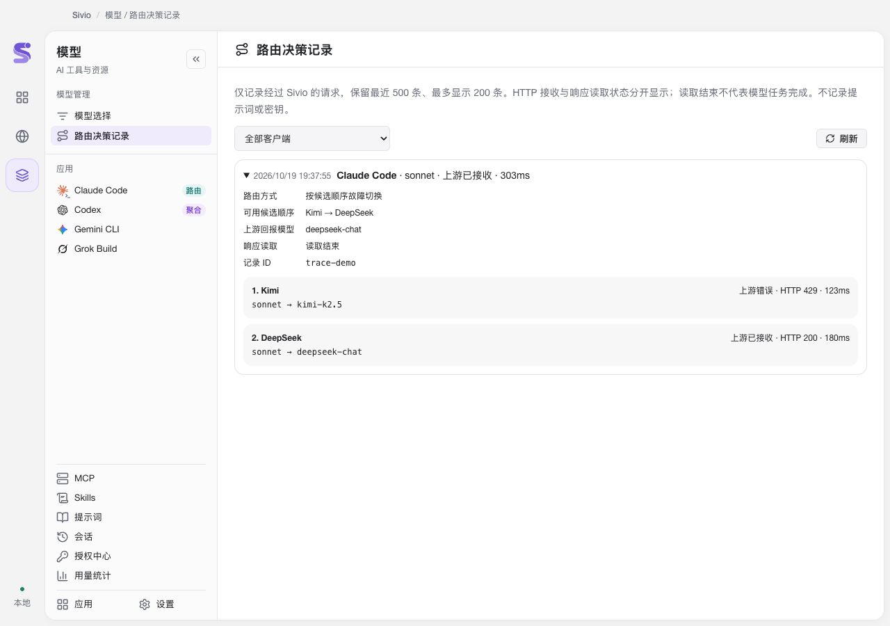
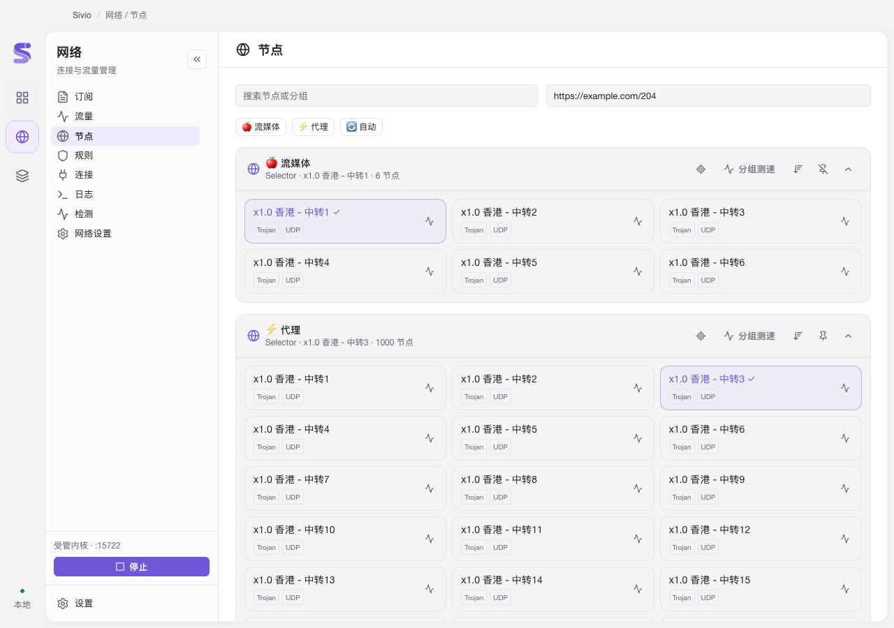
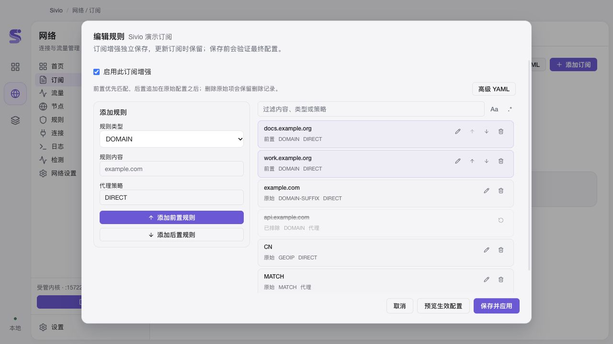

<p align="center">
  
</p>

<h1 align="center">Sivio</h1>

<p align="center"><strong>Your Shortcut to AI</strong></p>
<p align="center">在一个 macOS 工作区里，管理 AI 工具、模型与网络代理。</p>

<p align="center">
  <a href="#界面预览">界面预览</a> ·
  <a href="#功能亮点">功能亮点</a> ·
  <a href="#快速开始">快速开始</a> ·
  <a href="#操作图解">操作图解</a> ·
  <a href="#开发与构建">开发与构建</a> ·
  <a href="#文档">文档</a> ·
  <a href="#致谢">致谢</a>
</p>

Sivio 面向同时使用多个 AI 工具与模型供应商的开发者。它将供应商配置、模型选择、MCP、Skills、会话和网络管理放进同一个桌面应用，减少在配置文件和多个管理工具之间来回切换。

> **项目状态：开发与内部验收中。** 当前构建目标为 macOS 12+，提供 Apple Silicon 与 Intel 构建路径。内部包使用本地签名，尚未经过 Apple 公证；完整功能验收、Intel 与 macOS 12 真机验证仍未通过。详细状态见[实施记录](docs/implementation/progress.md)。

## 界面预览

以下截图使用应用界面与演示数据，模型、供应商、节点及请求结果均为示例；界面细节可能随版本更新。

### 模型管理

在「模型 → 连接总览」查看各客户端的连接模式，以及客户端、本地网关与供应商之间的关系。左侧可切换客户端，或进入 MCP、Skills、提示词等资源管理页面。



### 网络代理

在「网络 → 首页」集中查看当前订阅、用量与到期时间，选择代理组和节点，并管理系统代理、TUN 与代理模式。



## 功能亮点

### AI 工具与模型管理

- **集中管理供应商**：维护 API 地址、凭据与模型配置，通过各工具的适配器应用到客户端。
- **统一模型选择**：按供应商浏览、搜索模型，也可填写自定义模型 ID；在支持的客户端与连接模式下应用选择。
- **本地 AI 网关**：为 Claude Code、Codex、Gemini CLI 和 Grok Build 提供本地路由与失败切换；Claude Code 和 Codex 另有聚合模式。
- **查看连接与路由决策**：查看客户端、网关和供应商的连接关系，追踪经本网关转发的请求模型、候选顺序和实际尝试结果。
- **管理开发资源**：集中维护 MCP、Skills 与提示词，浏览项目、历史会话及用量记录。具体能力因客户端而异。

当前接入 Claude Code、Claude Desktop、Codex、Gemini CLI、Grok Build、OpenCode、OpenClaw、Hermes Agent、Pi 和 MiniMax Code 共十种工具。

工具接入不代表所有工具都支持相同的网关、MCP 或 Skills 功能。统一模型选择与路由记录的适用范围见[模型管理说明](docs/implementation/unified-model-hub.md)。

### 网络代理管理

- **订阅与配置**：导入、编辑和更新订阅，预览最终运行配置，管理 Merge、规则、节点、分组和 DNS。
- **节点与连接**：选择节点、测试延迟，查看流量、连接、规则与运行日志。
- **Mihomo 内核**：管理固定版本的 Stable / Alpha 内核，提供系统代理、PAC 与 TUN 模式。
- **独立网络服务**：提供服务安装、修复与卸载入口；需要特权的操作通过 macOS 系统授权完成。
- **AI 出站策略**：按需使用直连、Sivio 管理的网络或自定义代理；选择受管网络后，网络不可用会明确失败。

### 本地数据与备份

- 普通配置与凭据保存在本机 SQLite / JSON 中，使用私有目录与文件权限保护。
- 支持配置快照、导入导出，以及 WebDAV / S3 同步；包含秘密的可移植配置包使用口令加密。
- 提供旧版凭据迁移与 CC Switch / Clash Verge 数据导入入口，先预览再应用。

## 快速开始

当前以[源码构建](#开发与构建)生成内部应用包。构建完成后，打开对应架构目录下的 `Sivio.app`。

1. **添加供应商**：进入「模型」，选择需要管理的客户端，添加供应商并填写 API 地址、凭据与模型配置。
2. **选择模型与连接方式**：在客户端支持的模式下，选择直连、本地路由或聚合，并应用模型选择。已打开的客户端可能需要新建会话或重启才能读取配置。
3. **按需配置网络**：进入「网络」，导入订阅或配置，选择节点并启动；需要系统代理或 TUN 时，再启用相应选项并完成授权。
4. **检查实际状态**：通过连接总览、路由决策和网络日志确认配置是否生效。直连请求不经过 Sivio 网关，因此不会出现在路由记录中。

已有旧版数据的用户，先阅读[凭据迁移说明](docs/implementation/local-credential-storage.md)；从其他应用导入时，参考[迁移与冲突处理](docs/implementation/legacy-migration.md)。

## 操作图解

### 为客户端选择模型

1. 进入「模型 → 模型选择」，选择需要配置的客户端。
2. 搜索供应商或模型，点击目标模型；也可以手动填写自定义模型 ID。
3. 在右侧确认供应商与模型 ID，点击「应用选择」。



### 查看路由与失败切换

1. 进入「模型 → 路由决策记录」，按客户端筛选请求。
2. 展开请求，查看候选顺序、每次尝试的模型与 HTTP 状态。

图中演示首个供应商返回 HTTP 429 后，切换到另一供应商的过程。



### 选择代理节点

1. 进入「网络 → 节点」，搜索节点或分组。
2. 点击「分组测速」比较延迟，再点击支持手动选择的分组中的目标节点。

紫色高亮和勾选标记表示当前选择。



### 编辑订阅规则

1. 在「网络 → 订阅」打开目标订阅的规则编辑器，启用订阅增强。
2. 填写规则类型、内容与代理策略，选择添加为前置或后置规则。
3. 点击「预览生效配置」检查结果，再点击「保存并应用」。

订阅更新时会保留独立保存的增强配置。



## 开发与构建

技术栈：**Tauri 2 · Rust · React 18 · TypeScript · Vite · SQLite · Mihomo**。

### 环境要求

| 依赖     | 要求                                               |
| -------- | -------------------------------------------------- |
| 操作系统 | macOS，具备 Xcode Command Line Tools 与 macOS SDK  |
| Rust     | 1.99.0，当前项目固定工具链                         |
| Node.js  | 24                                                 |
| pnpm     | 10.13.1                                            |
| Python   | Python 3，用于构建与资源脚本                       |
| 签名工具 | macOS 自带 `codesign`、`security` 及可用的 OpenSSL |

以下命令从仓库根目录执行。先检查环境，再安装前端依赖：

```bash
python3 scripts/preflight.py
pnpm --dir app install --frozen-lockfile
```

### 构建应用

完整打包需要 `vendor/upstream/` 中的固定上游源码、`build/reports/upstream-manifest.json` 中的内核清单，以及对应架构的 Mihomo 缓存。缓存不随 Git 保存；缺少时，按固定清单下载并校验：

```bash
python3 scripts/fetch-mihomo.py --arch aarch64-apple-darwin --channel stable
python3 scripts/fetch-mihomo.py --arch aarch64-apple-darwin --channel alpha
python3 scripts/build-app.py --arch aarch64
```

Intel 交叉构建需先安装 Rust 的 `x86_64-apple-darwin` 目标，并将上述两条下载命令中的架构改为 `x86_64-apple-darwin`，然后运行：

```bash
python3 scripts/build-app.py --arch x86_64
```

构建脚本打包应用、网络运行组件和来源许可材料，完成本地签名与签名验证，并生成 ZIP 和更新归档。产物位于：

```text
dist/
├── internal-aarch64/    # Apple Silicon：Sivio.app 与归档
└── internal-x86_64/     # Intel：Sivio.app 与归档
```

构建日志、产物摘要与签名信息位于 `build/reports/`。当前生成的是内部调试包；交叉构建成功不代表已经完成 Intel 真机验收。

### 本地开发与检查

在应用所需网络资源已准备好后，可启动 Tauri 开发模式：

```bash
cd app
RUSTUP_TOOLCHAIN=1.99.0 pnpm dev
```

常用前端检查：

```bash
pnpm --dir app typecheck
pnpm --dir app test:unit
pnpm --dir app build:renderer
```

### 仓库结构

```text
app/          # 桌面应用：React 界面与 Tauri / Rust 后端
native/       # 网络 helper、进程守护与系统代理组件
scripts/      # 构建、资源获取与验证脚本
docs/         # 实施记录、功能说明与来源声明
openspec/     # 需求提案、设计与验收任务
vendor/       # 固定版本的上游源码
experiments/  # 早期技术验证，非当前业务应用入口
```

## 数据与兼容性

普通凭据使用本地文件权限保护，**并非加密存储**；有权以当前账户身份读取这些文件的进程可以读取凭据。旧版自有 Keychain 凭据需要在应用中主动选择「迁移旧凭据」，迁移期间可能出现多次系统授权；拒绝或暂停会保留进度与原数据。详见[本地凭据存储与迁移](docs/implementation/local-credential-storage.md)。

应用名称、安装包与默认深链接使用 **Sivio**（`sivio://`，兼容 `siassist://`）。为延续已有配置与服务，当前保留 `local.siassist.desktop` bundle ID、`SI Assist` 数据目录及既有服务标识；部分历史文档沿用旧名称。

## 文档

- [实施进度与待验收项目](docs/implementation/progress.md)
- [统一模型选择与路由决策](docs/implementation/unified-model-hub.md)
- [网络首页与状态面板](docs/implementation/network-home.md)
- [配置快照、备份与同步](docs/implementation/configuration-snapshots.md)
- [旧应用数据迁移](docs/implementation/legacy-migration.md)
- [原生网络运行组件](native/README.md)
- [需求提案与任务入口](openspec/changes/add-unified-ai-macos-app/proposal.md)
- [界面与 Logo 设计](openspec/changes/add-unified-ai-macos-app/design/design-map.md)

## 参与贡献

欢迎提交问题反馈与改进建议。反馈时请提供 macOS 版本、芯片架构、应用版本、复现步骤及经过脱敏的相关日志。

修改前请阅读 [AGENTS.md](AGENTS.md)；新增能力、架构调整或需求变更遵循 [OpenSpec 约定](openspec/AGENTS.md)。提交代码时请附上与改动相关的验证结果，并注明尚未覆盖的场景。

## 许可证

本项目采用 **GPL-3.0-only**，详见 [LICENSE](LICENSE)。复用的上游代码保留各自的版权与许可声明；固定版本、移植范围和随包材料见[第三方来源与许可证](docs/implementation/THIRD-PARTY-NOTICES.md)。

## 致谢

感谢以下开源项目的作者、维护者与贡献者。他们公开的代码与设计经验，为 Sivio 的实现提供了重要基础和启发：

- **[CC Switch（cc-switch）](https://github.com/farion1231/cc-switch)**：提供了多 AI 工具配置、供应商切换，以及 MCP、Skills、提示词等业务能力的代码基础与实践参考。
- **[Clash Verge（clash-verge）](https://github.com/zzzgydi/clash-verge)** 及其延续项目 **[Clash Verge Rev](https://github.com/clash-verge-rev/clash-verge-rev)**：为桌面网络代理管理提供了实践参考；Sivio 的网络配置合成与增强移植自 Clash Verge Rev 的固定源码基线。
- **[Magpie（magpie）](https://github.com/yetone/magpie)**：其统一模型目录、模型选择与本地网关路由设计，为 Sivio 的模型管理体验提供了启发。

同时感谢 [Mihomo](https://github.com/MetaCubeX/mihomo)、[Tauri](https://github.com/tauri-apps/tauri) 以及所有被本项目使用的开源依赖与社区贡献者。

## 版本发布与更新

Sivio 的 GitHub Releases 面向 macOS Apple Silicon，使用稳定内部签名。
应用内可检查、下载验证并确认安装更新；旧版首次接入需要手动安装带更新能力的版本。
构建、签名配置、tag 发布及恢复操作见 [版本发布手册](docs/implementation/releases.md)。
