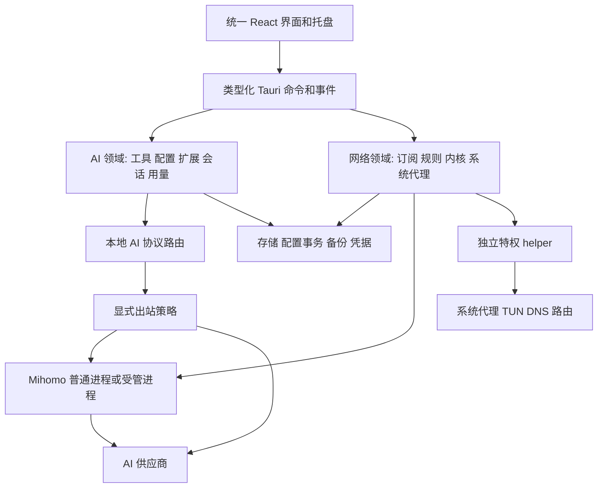

# Architecture Design

## Context
两个上游都使用 Tauri 2/Rust/React，但内部服务依赖各自全局状态、路径、事件和窗口。不存在已验证的即插即用库；直接合并 package.json、Cargo.lock、Tauri Builder 会引入身份冲突和生命周期竞争。本文规定移植边界，M0 验证实际耦合成本。

## Goals / Non-Goals
目标：单 App 内完整操作、可恢复配置写入、两类代理能协作、macOS 系统权限可控。非目标：微服务、通用插件宿主、网络内核重写、云平台、两个 GUI 嵌套。

## Decisions

### D1 单宿主与源码复用
采用 CC Switch 业务模块为起点；React UI 延续 Radix/Tailwind、TanStack Query，网络页面按统一组件体系移植。现阶段不引入 MUI/SWR 第二套通用体系；网络编辑器优先用已有 CodeMirror，补齐 YAML schema 诊断、补全与格式化验收，不要求 Monaco 品牌一致。

Rust 保持一个 Tauri Builder、一个进程级退出协调器；领域先用普通模块划分，不为每个模块建独立服务。CC 的 provider/live/mode/database/proxy 逻辑按来源清单移植；CV 的 profile/enhance/core/service/sysopt 逻辑通过新的路径、事件和存储边界适配。保留来源与补丁记录，依赖升级走差异复核。

不直接复用 AppHandle 全局单例、原 tray、原 updater、原 bundle ID 或整份 Tauri capability。T02 验证合并所需的 Rust/Tauri 版本；默认统一 Tauri 2、React 沿 CC 基线，不因网络 UI 原版使用更新 React 而强行升级全部依赖。

### D2 两类代理和端口所有权
AI Router 负责模型协议转换、聚合、供应商故障转移；Mihomo 负责网络出口、规则、DNS/TUN。两者单独展示状态，启停互不隐式联动。

AI 出站策略固定为 `direct | managed-network | custom-proxy`，默认 direct；该值表示应用层是否显式使用代理，不承诺绕过用户另行启用的系统级 TUN。managed-network 绑定本 App 的网络出口和 generation，不读取任意环境代理；网络服务不可用时明确失败，绝不静默直连。custom-proxy 禁止指向本 App AI 入口、自己的控制 API 或形成静态可识别环路。

AI 入口默认 127.0.0.1:16721、Mihomo mixed 默认 127.0.0.1:15722；优先使用 Unix socket 作内核控制。端口在启动时先绑定/核验，不能先显示成功再检查；冲突时保留现有服务，提示选择空闲端口，不抢占 7890 或终止其他进程。LAN 共享默认关闭；启用必须设置访问凭据并提示影响。

开启 TUN 时必须从捕获范围排除 loopback、控制 socket、内核自身出口，验证 DNS 引导和代理服务器连接不回流。Mihomo 出站 socket/路由排除采用其实际支持机制并由 T03 真机验证，不假设进程级 direct 能绕过 TUN。

#### 请求重试提交点
请求采用一份不可变配置快照（provider、模型、出口generation）；切换只作用后续请求。只有尚未向客户端发送响应内容且操作被判定可重试时，才允许路由队列切换。已发首个内容块后发生断流必须结束并返回可见错误，不拼接另一供应商流，不重新执行工具调用。包含外部副作用、未知幂等性或无法判定上游是否已处理的操作默认不自动重放；支持明确幂等键时按上游契约处理。默认总尝试≤3、建立连接/首响应总预算≤60秒；流持续时间由用户配置，取消必须传播。

### D3 macOS 特权服务
普通 AI 配置与普通网络代理不要求管理员。TUN 需要用户安装/授权服务；拒绝后保持普通模式可用，TUN 状态显示权限不足，不伪装成功。

移植 CV 已有 helper/service IPC 配对实现，保持协议兼容，使用独立 service ID、socket、数据根和安装目录；不用原版 Clash 服务。安装卸载采用上游 macOS 可用机制及系统授权，不以手写 sudo 通用 shell 代替。macOS 12 是目标下限；不无条件采用只适用于更高系统的 API。

helper 最小职责：启动受信任内核、应用网络设置、维护运行 lease、恢复本 App 修改的系统状态。helper 不处理 AI Key、不执行 Skills/MCP/任意配置脚本。授权通道绑定当前 uid/owner session；生产校验调用方身份与受信任可执行文件，拒绝任意路径、符号链接逃逸、任意参数拼接。具体上游支持差异由 T03 核实并修补后才开放 TUN。

helper 持久保存应用网络修改前快照与owner lease（root拥有、非符号链接、权限受限）；主进程每5秒续约，连续30秒无有效续约先恢复其仍拥有的系统代理/TUN/DNS，再终止受管内核。睡眠时间不直接当作进程丢失：唤醒后给一次10秒重连窗口，再判定过期。helper本身被杀时由独立launchd任务重启，读取快照并核验lease，先恢复失效会话后接受新连接。卸载或用户禁用后台服务之前要先恢复；若launchd也不可用，不能保证自动恢复，必须保留离线恢复指引并阻止宣称此项真机验收成功。

受管内核配置不是任意root文件访问入口：helper只接收经校验的运行bundle，所有provider/rule资源复制到受控目录，拒绝任意绝对路径、目录穿越、越界符号链接和可执行参数。内核二进制必须来自固定校验清单，不能接受前端指定可执行文件。T03验证上游是否满足这些要求，不满足部分是必要移植补丁。

### D4 数据与配置写入
应用私有根默认 `~/Library/Application Support/SI Assist/`：AI 库沿用 CC schema 迁移策略置于 `ai/`；网络运行材料位于 `network/`；网络目录/订阅正文以现有 SQLite `settings.si_assist_network` 单行保存，按照 2026-10-19 已批准的 update-local-credential-storage 方案以本地文件权限保护并使用修订 CAS。这是复用现有备份/同步边界的窄范围调整，不合并两套上游 schema；旧 SI Assist catalog 仅作为一次性迁移来源。通用 settings、journal、backups 独立。

2026-10-19 用户批准参考 CC Switch：普通元数据与新增凭据序列化到本机 SQLite/JSON，应用目录0700、数据文件0600；同账户且具有文件访问权限的进程可读取。旧 Keychain 引用仅在显式迁移时解引用，正常启动不触发授权。上游必要的明文 live 配置按客户端协议写入，Unix 权限 0600；不承诺外部 CLI 文件完全无明文。网络配置内嵌的订阅认证信息也视为敏感数据，不仅 API Key。

所有会改写多文件的操作带 operationId、baseHash 和 generation：读取基线 → 校验/预览 → 备份 → staging → 写入 pending journal → 原子替换各文件 → 验证生效 → 提交 active 状态。单文件 rename 不是跨文件事务；启动恢复按 journal 和当前 hash 判断续做或恢复，遇到外部修改停止并显示冲突。

数据库事务与文件发布由同一协调器串行化；不持有数据库锁等待网络或用户交互。只有涉及资源有共同写入时才共用锁，例如项目切换锁住所属 CLI 文件；网络订阅更新不锁整个 AI 域。

导入旧数据库中的凭据以本地数据保存，不再重新创建 Keychain 条目；遗留自有引用保留为待迁移状态；导入staging和原格式敏感备份权限0600，成功后按保留策略清理本App的临时明文副本，不删除原App数据。需要保留上游原始格式的明文导出由用户单次明确选择，界面提示其中包含秘密；默认诊断和普通导出无秘密。

旧SQL备份不得直接在活动数据库执行：在禁用extension、ATTACH、外部文件访问的隔离临时SQLite中只接受批准的schema和数据语句，校验表/字段/大小后通过DAO导入。归档限制解压后大小与条目数并防ZIP炸弹（默认总量≤1GiB、单文件≤256MiB、条目≤100,000；超限显示原因）。

### D5 配置迁移与共存
初次启动可扫描已安装客户端和两个旧 App 的数据，但默认只读。用户选择来源后复制到 staging，核对 schema、来源版本和路径，显示数量/冲突/敏感信息范围；备份完成后提交到本 App 私有目录。重复导入按 sourceId+entityId+hash 去重；新于支持 schema 的数据库拒绝写入。

不接管旧 App 数据库、不安装为旧 bundle ID、不占用原 deep-link scheme。可在导入框解析 ccswitch/clash 链接内容，但只注册 `siassist://`。移植后的上游导入/导出格式能力仍保留，由兼容适配器处理。

对原 CLI 文件需要取得本 App 写入权限；旧 App 正在管理同一文件时先提示暂停其管理。锁只保护本 App，不能假定其他应用遵守锁；每次发布都重新核对 hash。系统代理采用快照与所有权检查，外部改变后暂停守卫并提示，不与另一个代理客户端反复争抢。

### D6 生命周期与失败策略
桌面窗口关闭默认隐藏；轻量模式销毁 WebView 后，后台 AI/网络服务与托盘继续运行；重建窗口先取快照，再订阅带 sequence 的状态事件，断档重取快照。

网络状态 `stopped/starting/running/reconfiguring/stopping/failed` 与 helper 权限状态分开。每个操作有 operationId 和 generation，过期事件不能把新状态覆盖成旧成功。AI route 同样区分期望和实际生效状态。

明确退出：拒绝新 AI 请求，已有请求最多排空 10 秒；恢复仍由本 App 拥有的 CLI 配置；恢复系统代理/TUN/DNS；停止内核和 helper session 后退出。失败时显示恢复入口并保留 journal，不能无条件宣称清理成功。强制杀进程后由 helper lease 负责网络恢复，CLI 文件在下次启动恢复；AI Router 不在进程被杀后继续服务，这是明确限制。

睡眠唤醒和网络切换后重新探测内核、服务与实际代理状态；不盲目重装 helper。内核异常最多 3 次/60 秒自动恢复，超限进入 failed 并提示；依赖 managed-network 的新请求失败返回，不静默更换出口。

### D7 UI 和 IPC
侧栏：概览、AI 工具、MCP、Skills、提示词、项目、会话、用量、授权中心、网络（订阅/节点/规则/连接/日志/检测）、设置。共享设置下分 AI、网络、数据、外观、关于；高级选项逐步展开。

命令按 ai.* / network.* / data.* / app.* 分组；统一 Result 的 code/message/retryable/operationId/details（details 脱敏）。长任务有进度和取消；前端缓存不充当真实状态来源。命令参数校验和文件根权限在 Rust 执行。

远程订阅、Markdown、图标、脚本都是不可信输入；WebView 不加载具有 Tauri 权限的远程站点。保留 CSS 自定义能力，但限制外部 URL/资源加载。脚本在受限引擎/工作线程执行，默认禁止 filesystem/process，5 秒超时、16 MiB 输入上限；用量脚本网络只开放用户确认的目标。配置脚本与 root helper 隔离。

#### 客户端安装与用量归并约定
支持上游已支持安装来源的单项/批量安装升级；保存安装来源、可执行路径和原版本。具备快照或固定版本重装能力的受管来源先准备恢复材料；不可事务回滚的安装器首次执行前提示影响，失败标记 needs-repair，提供重装/修复，不宣称旧版仍可用。未知来源只检测和提供指引，不任意覆盖。

用量归并优先使用客户端ID+会话ID+消息/请求ID作为唯一键；路由记录有明确关联ID时才和会话记录合并。缺乏可证明关联的记录分来源显示，汇总使用用户选定主来源并显示未合并数量，不以时间相近猜测去重后给出精确账单。价格缺失为unknown，成本用十进制定点计算（展示6位小数，汇总前不逐条截断）。

### D8 更新、备份与分发
一个应用更新入口，使用 SI Assist 自己的更新源、公钥和版本；更新源未配置时明确不可用，不能指向任一上游更新包。Mihomo 稳定/Alpha 版本可以选择，但每次实际安装校验固定版本、架构、摘要和可信来源，失败保留旧内核。

本地数据库安全备份保留两个域的同一事务视图；可移植 `.siassist` 配置包带统一 manifest，并包含 AI、网络和 Skills。运行日志、helper 凭据和本机 OAuth 会话不进入配置同步包；完整本机数据备份与配置包在界面区分。恢复先验证 SQL/归档，在私有目录持久保存数据库与 Skills 的回滚快照，写入前后修订用于中断恢复；不认识的外部改动保留并报冲突。WebDAV/S3 使用 SI Assist 独立前缀，不自动覆盖上游云端目录。远程 revision 冲突需要选择版本，不以 last-write-wins 静默处理。运行端口、PID、helper owner session 不同步。默认云备份排除凭据、原始会话正文和带秘密的原始URL，导入后显示待补充凭据。用户明确选择包含秘密时，导出/上传前使用版本化的 Argon2id 派生参数与 AES-256-GCM 认证加密封装，盐/nonce随机独立，使用成熟库，不设计自定义密码算法；口令不上传，保存在本机私有配置文件须单独选择并说明本地可读。错误口令或认证失败在写入活动目录前拒绝。明文上游SQL兼容导出不允许作为自动同步载荷。T24用固定测试向量和篡改样本验收。

## Migration Plan
T01 固定来源 → T02/T03 验证合并及权限 → T04 端到端样条 → M1 数据/GUI → M2 代理核心 → M3 功能补齐 → M4 真机回归。每阶段保留前一工作包，迁移前备份。更新数据库失败不得自动用旧程序读取新 schema；恢复备份后才能降级。

## Risks / Trade-offs
选择源码移植减少成熟协议逻辑重写，但承担跟踪上游修复和移植测试成本。统一 UI 增加网络页面迁移量，换取一套可维护组件体系。M0 的验证是进入后续代码阶段的条件，本轮静态研究不能证明全部依赖已兼容。

## Open Questions
无影响开始 M0 的产品问题。发布方式、品牌、更新域名、证书由内部交付/外部分发前确定；不能假定已获得。完整功能交付仍需真实 AI 测试账号、网络订阅及两架构设备。

## UI Design Reference
视觉和交互实现前先阅读 [设计资产索引](design/design-map.md)、[视觉规范](design/design-system.md)、[交互边界](design/interaction-spec.md)。可直接打开 [HTML原型](design/index.html)。设计原型中的JS只模拟UI，不替代Rust状态机、系统权限或验收规范；产品业务行为以specs为准。

### 实施补充：revision 9 系统代理主机
为覆盖固定 CV 基线的 proxy_host，helper revision 9 增加纯数据地址校验：系统代理目标可为明确配置的 ASCII 主机名或单播 IP；拒绝 URL、userinfo、端口拼接、控制字符、未指定/组播/广播地址。默认仍为 127.0.0.1，非 loopback 目标保存时提示其接收系统代理流量，实际启用前再经原生确认；许可只保留于当前进程，不随配置备份恢复。私有控制 socket、helper peer/CDHash/UID 身份校验、lease、SCPreferences 所有权 CAS 均不放宽；外部面板由普通用户进程的 loopback bearer/CORS 桥接提供固定操作集合，不把特权 Mihomo 控制 socket 暴露为任意 HTTP API。旧 revision 8 仍支持原有 loopback/TUN 操作；自定义目标以 revision 9 能力门控，不能静默回退。真实安装 revision 9 与目标切换验收另行记录，原 revision 8 真机证据不冒充新版本验收。
